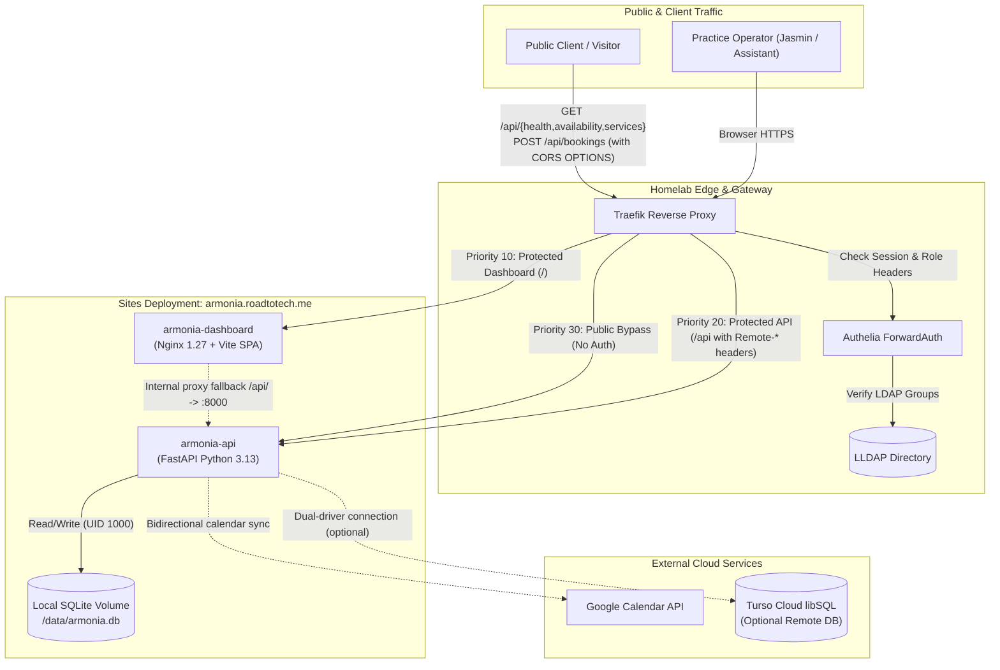
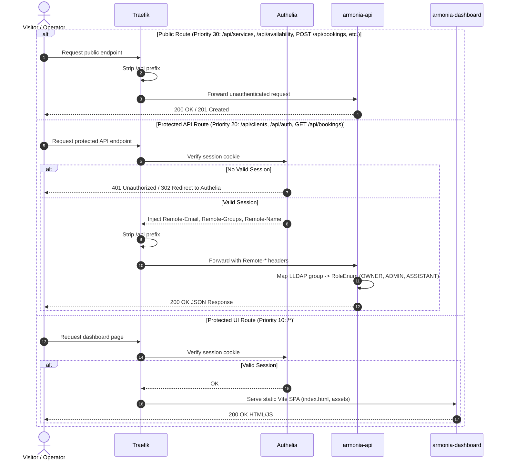

# Architecture: Homelab Sites Orchestration (`armonia`)

This document defines the canonical present-state system architecture and deployment topology for **Armonía del Ser** running within the self-hosted Homelab Sites environment at `armonia.roadtotech.me`.

---

## 1. System Overview

The Homelab Sites deployment packages the Armonía del Ser platform as a containerized, self-hosted composition providing both the administrative operator control surface and the public scheduling backend. It integrates directly with the Homelab's reverse proxy ([Traefik](https://traefik.io/)), single sign-on / forward-auth identity provider ([Authelia](https://www.authelia.com/)), and directory service ([LLDAP](https://github.com/lldap/lldap)).

---

## 2. Architectural Principles

1. **Defense in Depth**: Public intake routes are narrowly whitelisted at the Traefik edge. All administrative routes (`/api/bookings/*`, `/api/clients/*`, `/api/auth/*`, `/api/rosters/*`) enforce strict role-based access control inside the FastAPI application via `AUTH_PROVIDER=proxy_headers`.
2. **Offline-Tolerant Local State**: The deployment operates autonomously using a bind-mounted local SQLite volume (`./data:/data`) without mandatory external database dependencies.
3. **Decoupled Identity**: Application containers store no master user passwords or LDAP credentials; user identity and group memberships are asserted securely via upstream Authelia proxy headers (`Remote-Email`, `Remote-Groups`, `Remote-Name`, `Remote-User`).
4. **Predictable Immutability**: Production dashboard assets are compiled into immutable static files served via Nginx with aggressive HTTP caching for static bundles (`/assets/`) and SPA fallback routing.

---

## 3. Components & Responsibilities

| Container / Service | Image / Build Base | Responsibilities | Exposed Port | Bound Volumes / Networks |
| :--- | :--- | :--- | :--- | :--- |
| **`armonia-api`** | Git Context (`armonia-api.git#main`) with `uv` + Python 3.13-slim | Operational backend: booking engine, availability calculation, client CRM, JIT admin allowlisting, Google Calendar sync, and schema auto-migration. | 8000 (Internal) | `./data:/data` (UID 1000:100), `proxy-net` |
| **`armonia-dashboard`** | Multistage [`Dockerfile.dashboard`](./Dockerfile.dashboard) (Node 22 pnpm builder -> Nginx 1.27 Alpine) | Serves the responsive, mobile-first Vite SPA administrative dashboard. Includes an internal Nginx proxy fallback forwarding `/api/` to `armonia-api:8000` with Authelia headers. | 80 (Internal) | `proxy-net` |
| **`Traefik`** *(External)* | Homelab Core Service | SSL termination, routing rules, strip-prefix middleware, and Authelia ForwardAuth enforcement. | 80, 443 (Host) | `proxy-net` |
| **`Authelia`** *(External)* | Homelab Core Service | Evaluates session cookies, validates credentials against LLDAP, and injects authenticated identity headers. | Internal | `proxy-net` |

---

## 4. Routing & Authentication Boundaries

Routing decisions are handled in Traefik based on priority and path matching:

### Traefik Routers Specification

1. **`armonia-api-public` (Priority 30, Public)**:
   - **Rule**: `Host(SERVICE_DOMAIN) && (PathPrefix('/api/health') || PathPrefix('/api/availability') || (Method('GET', 'HEAD', 'OPTIONS') && PathPrefix('/api/services')) || (Method('POST', 'OPTIONS') && PathPrefix('/api/bookings')))`
   - **Middleware**: `armonia-api-strip@docker` (strips `/api`).
   - **Target**: `armonia-api:8000`.
   - **Authentication**: None (Bypasses Authelia).

2. **`armonia-api` (Priority 20, Protected Operator API)**:
   - **Rule**: `Host(SERVICE_DOMAIN) && PathPrefix('/api')`
   - **Middleware**: `authelia-auth@docker`, `armonia-api-strip@docker`.
   - **Target**: `armonia-api:8000`.
   - **Authentication**: Authelia ForwardAuth enforces authenticated session and forwards headers.

3. **`armonia-dashboard` (Priority 10, Protected Operator UI)**:
   - **Rule**: `Host(SERVICE_DOMAIN) && PathPrefix('/')`
   - **Middleware**: `authelia-auth@docker`.
   - **Target**: `armonia-dashboard:80`.
   - **Authentication**: Authelia ForwardAuth.

4. **`armonia-red` (HTTP to HTTPS Redirect)**:
   - **Rule**: `Host(SERVICE_DOMAIN)` on entrypoint `web`.
   - **Middleware**: `https-redirect@docker`.

---

## 5. Security & Decoupled Role Mapping

When `AUTH_PROVIDER=proxy_headers` is set:
1. `armonia-api` trusts upstream headers injected by Traefik from Authelia:
   - `Remote-Email`: Normalized email address of the authenticated operator.
   - `Remote-Name`: Full display name of the operator.
   - `Remote-Groups`: Comma-separated list of LLDAP group memberships.
2. In `app.core.auth`, incoming groups are mapped in descending order of privilege:
   - `armonia-owner` $\to$ `RoleEnum.OWNER` (Jasmin)
   - `armonia-admin` $\to$ `RoleEnum.ADMIN`
   - `armonia-assistant` $\to$ `RoleEnum.ASSISTANT` (Assistant)
3. **Just-In-Time (JIT) Actor Provisioning**:
   When an authenticated operator initiates a state mutation (such as recording a payment or completing a clinical session), `armonia-api` automatically mirrors the user into the local `admin_allowlist` table to satisfy foreign-key referential integrity for `admin_audit_log`.

---

## 6. Persistence & State Boundaries

- **Local SQLite Engine (`DATABASE_URL=file:/data/armonia.db`)**:
  - The SQLite database is stored on the host filesystem under `./data/armonia.db` and bind-mounted to `/data` in the container.
  - Initialized on boot via FastAPI lifespan ([`app.db.init_db`](https://gitea.roadtotech.me/armonia-del-ser/armonia-api)) using WAL mode and Foreign Key enforcement (`PRAGMA foreign_keys=ON`).
- **Turso Cloud LibSQL Driver Support**:
  - The backend natively supports both local SQLite and remote Turso libSQL endpoints via `get_engine_url()` in `app.db.database`. Switching between local storage and cloud database requires only updating `DATABASE_URL` and `DATABASE_AUTH_TOKEN` in `.env`.

---

## 7. Dependencies & Runtime Constraints

- **Proxy Network**: Containers attach to the external Docker network `proxy-net` managed by the Homelab Core compose stack.
- **User IDs**: `armonia-api` executes under UID `1000:100` to maintain clean file ownership on host bind mounts.
- **CORS Configuration**: Restricted to `https://${SERVICE_DOMAIN}` and `https://armonia-landing.pages.dev`.

---

## 8. Decision Log Index

- [ADR-0001: Containerized Homelab Sites Orchestration & Dual-Router Architecture](./docs/adr/0001-homelab-sites-orchestration.md)
